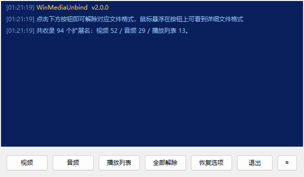

<div align="center">

<h1>Win Media Unbind</h1>

[](https://www.rust-lang.org/)
[](https://www.microsoft.com/windows)
[](LICENSE)

</div>

**WinMediaUnbind** 是一个基于 Rust 的轻量级 Windows 工具，一键解除 94 种视频、音频与播放列表格式的默认程序关联，并在解除前自动备份、随时可还原。

> **🎯 项目起源**
> 影音格式被某些程序强行关联后，用户想按自己的偏好重新设置却处处受阻。本工具可以强行解除这些关联，把"用什么打开"的选择权还给用户。



## ✨ 功能特性

- **一键解除**：视频 / 音频 / 播放列表 / 全部解除，四个按钮覆盖 94 种格式。
- **先备份再清理**：每次操作前把将被删除的注册表项导出为一份独立备份，并**校验备份与当前注册表完全一致**后才执行清理；校验不通过则中止，不删除任何键。
- **可随时恢复**：「恢复选项」列出全部历史备份，选中后一键写回注册表。
- **即时生效**：清理与恢复后调用 `SHChangeNotify`，图标与打开方式立即刷新，无需重启资源管理器。
- **悬浮提示**：鼠标悬停在分类按钮上可查看该组包含的全部扩展名。

> 程序需要管理员权限（清单中声明 `requireAdministrator`），启动时会弹出 UAC 确认。

## 💾 备份与恢复

- **备份位置**：程序所在目录下的 `WinMediaUnbinBackup` 文件夹，不存在时自动创建。
- **备份内容**：即将被删除的注册表键值，按原类型记录（`REG_SZ` / `REG_EXPAND_SZ` / `REG_MULTI_SZ` / `REG_DWORD` / `REG_QWORD` / `REG_BINARY` / `REG_NONE`）。
- **恢复方式**：点击「恢复选项」→ 在列表中选择一份备份 → 点击「恢复此项」。

> **关于"系统默认应用记录"**
> Windows 会把每个扩展名的默认应用单独记在 `HKCU\...\FileExts\.ext\UserChoice`，该键带有 Deny 访问控制与私有哈希校验，**任何第三方程序都无法写入**（包括播放器自带的关联修复）。
> 因此恢复时这部分记录会被跳过，日志显示为"另有 N 个系统默认应用记录受保护，已跳过，不影响实际关联"。
> 实测不影响实际关联：恢复后系统真正调用的程序与备份前完全一致。

## 📂 涉及的文件格式

### 视频（52种）

```text
avi wmv wmp wm asf mpg mpeg mpe m1v m2v mpv2 mp2v ts tp tpr trp vob ifo ogm ogv mp4 m4v m4p m4b 3gp 3gpp 3g2 3gp2 mkv rm ram rmvb rpm flv mov qt nsv dpg m2ts m2t mts dvr-ms k3g skm evo nsr amv divx webm wtv f4v mxf
```

### 音频（29种）

```text
wav wma mpa mp2 m1a m2a mp3 ogg m4a aac mka ra flac ape mpc mod ac3 eac3 dts dtshd wv tak cda dsf tta aiff aif opus amr
```

### 播放列表（13种）

```text
asx m3u m3u8 pls wvx wax wmx cue mpls mpl dpl xspf mpd
```

## 🔧 工作原理

1. 删除 `HKEY_CLASSES_ROOT\.ext` —— 文件类型注册（图标与默认 ProgId）。
2. 删除 `HKCU\Software\Microsoft\Windows\CurrentVersion\Explorer\FileExts\.ext` —— 用户级打开方式记录。
3. 调用 `SHChangeNotify(SHCNE_ASSOCCHANGED)` 通知系统刷新图标与关联。

清理前会先把上述两处内容导出到备份文件，并重新读取注册表与备份比对，一致才继续。

## 🚧 已知限制

- **`UserChoice` 无法写入**：见上文说明，清理后 Windows 可能为视频类型重建一条指向系统"电影和电视"的记录；当它与实际注册不符时系统会忽略它，实际打开方式仍以 `HKCR` 为准。
- **恢复是覆盖式**：只写回备份中记录的值，不会删除备份之后新增的值。
- 解除关联后双击文件会弹出"您想如何打开此文件？"，这是预期行为。

## ⚠️ 警告

本程序会删除注册表中的文件关联项，**修改注册表始终存在风险**。

- 执行清理前，请先确认 `WinMediaUnbinBackup` 目录中已生成对应备份。

## ⬇️ 下载使用

[](https://github.com/NeetheCheeBao/WinMediaUnbind/releases)

## 🛠️ 本地编译

1. 克隆仓库

```bash
git clone https://github.com/NeetheCheeBao/WinMediaUnbind.git
```

或者

```bash
gh repo clone NeetheCheeBao/WinMediaUnbind
```

2. 一键编译

```bash
.\build.bat
```

## 📁 项目结构

```text
WinMediaUnbind
|   .gitignore
|   build.bat             # 一键编译脚本
|   build.rs              # 构建脚本：注入版本常量、生成资源脚本、探测 rc.exe
|   Cargo.lock            # 依赖版本锁定
|   Cargo.toml            # 依赖与编译配置（版本号由 version.ini 提供）
|   LICENSE
|   README.md
|   version.ini           # 程序名称与版本，构建时注入程序
|
+---res
|       icon.ico          # 程序图标
|
+---screenshot
|       demo1.png         # 界面截图
|
\---src
        app.rs            # 主窗口控件、事件分发、布局，以及恢复列表窗口
        backup.rs         # 备份导出、备份校验、恢复写回
        cleaner.rs        # 扩展名清单与注册表清理流程
        logger.rs         # 清理线程与界面线程之间的日志队列
        main.rs           # 入口：初始化界面、DPI、全局字体、版本常量
        terminal.rs       # 彩色终端控件：富文本框封装、滚轮滚动、隐藏插入符
        theme.rs          # 配色与日志级别定义
        winffi.rs         # 手写 Win32 API 声明与封装
```

## ⚖️ 许可证

本项目采用 MIT 许可证 - 详情请参阅 [LICENSE](LICENSE) 文件。
